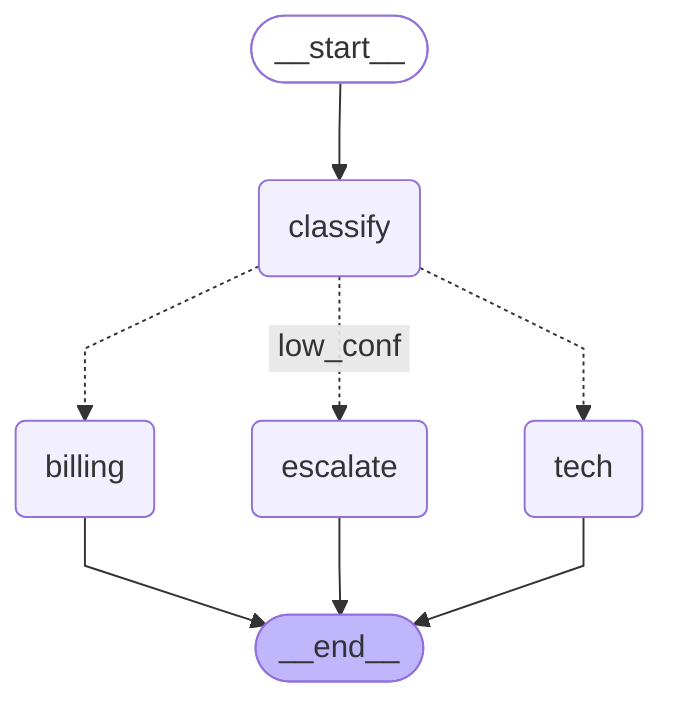
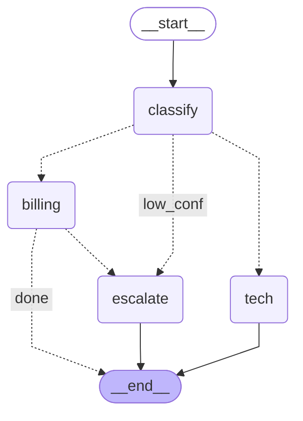
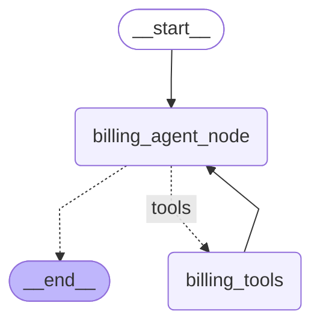

# NovaCart node architecture and implementation progress

Snapshot: 11-10-2026 (IST). Project: `D:/AGENT PROJECT`.

The diagrams below come from `workflow.get_graph().draw_mermaid()` after compilation. The current diagram uses your actual backend files. The Stage 4 diagrams use the previously checked guide examples in a temporary folder, to show the complete Stage 4 design; your internal billing module is now present but the outer billing node is not connected to it yet. No agents, Groq requests, refunds, or embedding requests ran while generating these diagrams.

## 1. Current graph in your backend



The outer graph has four nodes. START and END are graph markers; the conditional routing function is an edge, not another agent.

| Node | What your current code does |
| --- | --- |
| `classify` | Calls the structured classifier and writes category, confidence, reasoning, and route. Classification errors, low confidence, and anger keywords route to escalation. |
| `billing` | Returns `PENDING_SPECIALIST` with a placeholder response. It does not call the lookup tool or issue a refund yet. |
| `tech` | Returns `PENDING_SPECIALIST` with a placeholder response. RAG is still pending. |
| `escalate` | Returns `ESCALATED` and a review response. A human-review queue and approval/resume are still pending. |

For confident classification, billing goes to billing; tech and general go to tech. Confidence below 0.6, anger keywords, or classifier failure go to escalate. All three current branches terminate at END.

## 2. Full outer graph written in Stage 4

Guide design; not yet wired into your backend:



The outer node count stays at four. Stage 4 replaces the billing placeholder with a wrapper around the internal billing graph. After billing returns, `route_billing` sends a review outcome to `escalate`, or an answered outcome to END. The tech node remains a placeholder until Stage 5.

## 3. Internal billing graph written in Stage 4

This graph is now defined in billing_agent.py, with billing_agent_node and billing_tools as its graph labels. The Stage 4 design invokes it inside the outer billing node; that connection is still pending in your backend:



| Internal node or edge | Responsibility |
| --- | --- |
| `billing_agent_node` | Uses the Groq model with bound tools, supplies trusted customer/ticket arguments, reads tool results, and prepares the final response or review reason. |
| `billing_tools` | A `ToolNode` executing the permitted `get_order` or `issue_refund` call. These two tool functions are not two additional graph nodes. |
| `tools_condition` | Routes an AI message with a tool call using the library's tools label, mapped explicitly to `billing_tools`; a final message goes to the internal END. |
| `billing_tools -> billing_agent_node` | Returns the tool result as a ToolMessage so the specialist can continue. |

The wrapper initializes fresh messages and trusted context, invokes this internal graph, and returns response/status/tool outcomes to the outer TicketState. Because this wrapper translates between two state schemas, inspect the outer and inner compiled graphs separately to see every node.

Typical successful refund: outer classify -> billing; internally billing_agent_node -> get_order through billing_tools -> billing_agent_node -> issue_refund through billing_tools -> billing_agent_node -> internal END; billing returns -> outer END. A policy refusal returns a review result and follows billing -> escalate -> outer END.

The Stage 4 guide permits one tool request per turn and at most three model calls. Python enforces ownership, eligibility, remaining balance, positive integer paise, the automatic/cumulative INR 5,000 limit, and duplicate prevention. Example: INR 2,500.00 is 250000 paise. The mock refund ledger is in memory and is lost on restart.

## 4. How far the actual implementation has reached

| Part | Current evidence | What remains |
| --- | --- | --- |
| Stage 1: setup | Virtual environment and Git setup were verified earlier. | Completed setup. |
| Stage 2: classifier | `model.py`, `schemas.py`, `classifier.py`, demo, and classifier tests are present. | Full milestone verification and live Groq behavior are not established by this architecture check. |
| Stage 3: routing | `state.py`, `graph_nodes.py`, and `triage_graph.py` are present; the actual graph compiles and exports the expected four nodes. | This check establishes graph shape, not all routing behavior or a completed stage milestone. |
| Stage 4.1: mock store and lookup | `mock_store.py` contains seeded INR records and an empty refunds dictionary; `get_order` is defined in `billing_tools.py`. | Connect lookup to the billing agent. |
| Stage 4.2: refund tool | `RefundInput` and `issue_refund` are now present. | Verify the actual tool policy and mutations through the project billing checks. |
| Stage 4.3: billing graph | `billing_agent.py` now defines the internal billing graph. | The outer billing node is still a placeholder; its wrapper connection and billing-to-escalation edge remain pending. |
| Stage 4.4: billing checks | The previous rewrite passed 24 offline tests using temporary guide examples. | These are not tests of your current backend. Billing tests and the billing demo are not present there yet. |
| Stage 5 onward | Roadmap only. | Technical RAG, a review queue, API/database, persistence/approval, and frontend remain later work. |

**Current stopping point: the Stage 3 routing graph is present, and Stage 4 has started with mock data, get_order, issue_refund, and the internal billing graph. Full Stage 4 is not implemented yet. The guide is expanded through full Stage 4.**

## 5. View the current compiled graph yourself

In PowerShell:

```powershell
Set-Location -LiteralPath 'D:/AGENT PROJECT/backend'
& './.venv/Scripts/python.exe' -c "from triage_graph import workflow; print(workflow.get_graph().draw_mermaid())"
```

This prints Mermaid text. The Mermaid blocks in this document show that text as diagrams in a Markdown viewer with Mermaid support.

To save a PNG from the current compiled graph:

```powershell
Set-Location -LiteralPath 'D:/AGENT PROJECT/backend'
& './.venv/Scripts/python.exe' -c "from triage_graph import workflow; workflow.get_graph().draw_mermaid_png(output_file_path='../triage_graph.png')"
```

This creates `D:/AGENT PROJECT/triage_graph.png`. The default PNG renderer uses the Mermaid.ink service and needs internet access; the Mermaid text export above works locally. Compiling/exporting the current graph does not invoke the classifier or call Groq. See the [official LangGraph visualization examples](https://docs.langchain.com/oss/python/langgraph/use-graph-api#visualize-your-graph).

In a notebook with IPython installed, the familiar image display is:

```python
from IPython.display import Image, display
from triage_graph import workflow

display(Image(workflow.get_graph().draw_mermaid_png()))
```

The internal billing module is present, so you can now export both graphs:

```python
from triage_graph import workflow
from billing_agent import billing_workflow

print(workflow.get_graph().draw_mermaid())
print(billing_workflow.get_graph().draw_mermaid())
```

The internal billing module's presence does not establish that the outer billing node calls it. This naming change does not implement that connection or advance to later stages.
